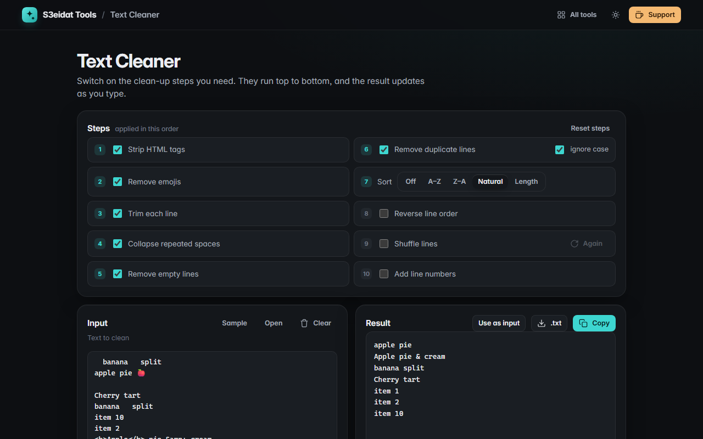

# Text Cleaner

> Remove duplicates, extra spaces, sort lines. Free, private, and it runs entirely in your browser.

### ▶ [Open Text Cleaner](https://s3eidat.github.io/text-cleaner/)



## Features

Switch steps on and off; they always run in this order and the result updates live:

1. **Strip HTML tags** (drops scripts, styles and comments, turns paragraphs and `<br>` into line breaks, decodes `&amp;` and friends)
2. **Remove emojis** (including skin tones, flags and joined emoji; keeps © ® ™)
3. **Trim** each line
4. **Collapse** repeated spaces and tabs
5. **Remove empty lines**
6. **Remove duplicate lines**, optionally ignoring case (the first occurrence is kept)
7. **Sort** A–Z, Z–A, natural (`item 2` before `item 10`) or by length
8. **Reverse** line order
9. **Shuffle** (uses the browser's cryptographic random generator)
10. **Add line numbers**

Shows lines in and out, duplicates and empty lines removed, and characters. Open a file, copy, download `.txt`,
or feed the result back in. Your chosen steps are remembered on this device.

## Privacy

Your text never leaves your device. There is no server, no account, no analytics.
The page ships with a strict Content-Security-Policy (`connect-src 'self'`), so the browser
itself blocks any attempt to send data anywhere.

## Run it yourself

It's plain HTML, CSS and JavaScript with no build step:

```bash
git clone https://github.com/s3eidat/text-cleaner
cd text-cleaner
python -m http.server 8000
```

Then open http://localhost:8000.

## Support

If this saved you time, **[buy me a coffee ☕](https://s3eidat.github.io/coffee/)**. It keeps every tool free.

---

Part of **[S3eidat Tools](https://s3eidat.github.io/)**: 100+ free, private tools that run in your browser. MIT licensed.
